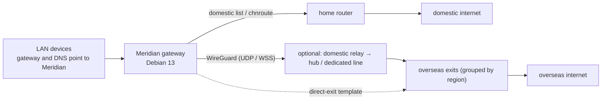

# Meridian

[简体中文](README.md) | English

License: `AGPL-3.0-only`

Meridian is a WireGuard policy-routing gateway with a web panel that runs on your home LAN. Point a device's gateway and DNS at it: domestic traffic goes direct through your home router as before; foreign traffic follows your rules and region groups through your own servers (optional domestic relay, overseas hub or dedicated line) and leaves from the exit you choose. When the tunnel is down it fails closed and never silently falls back to the home uplink.

No Fake-IP and no client apps on devices. Your home router and any existing proxy gateway stay untouched: Meridian runs alongside them, and only devices pointed at it go through it.



## Topologies

The first-run wizard offers four templates; diagrams are in [docs/user/topologies.md](docs/user/topologies.md):

| Template | Path | Suits |
|---|---|---|
| Direct exit | gateway → exit | the exit's line to home is already good enough |
| Single relay | gateway → domestic server (also hub) → exit | one domestic hop is needed |
| Relay + hub | gateway → relay → hub → exit, optional standby hub (gateway dials WSS directly, or via a set of standby relays) | several exits, backup paths |
| Dedicated line | gateway → relay → dedicated line (managed primary hub) → exit, optional standby hub | you have a dedicated line |

## Features and how it works

```
LAN device ─┬─ DNS (53/853 always hijacked) → SmartDNS resolves by rule, answers go into that rule's nftset
            └─ connection → nft checks the sets in rule order → sets an fwmark
                 ├─ domestic → home router, direct
                 ├─ exit / region group → source rewritten → WireGuard → relay / hub picks the exit by source
                 ├─ reject → RST / ICMP unreachable
                 └─ unclassified / tunnel down → blackhole
```

- **Routing**: an ordered rule list, first match decides (region group, exit, direct, reject), then the domestic list, chnroute and the default group. The gateway classifies by the addresses it learns from DNS.
- **Name sniffing** (optional): reads the name from TLS SNI / HTTP `Host` before choosing a path, so devices that bypass the gateway DNS are still routed by name.
- **Leak protection**: DNS is hijacked and known DoH blocked; a down tunnel means blackhole, never the home uplink; tunneled names get no AAAA.
- **Transport and failover**: UDP and WSS legs from gateway to relays; multiple relays share load by path quality; the standby hub takes over when the primary is unreachable end to end; region groups fail over in order.
- **Cloudflare Mesh** (optional): a hub can switch between the direct path and Mesh to the same exit. The exits page shows the active path, latency, loss and why it switched.
- **Unlock probing**: probes platforms from a chosen exit and recommends exits per region, adopted after you confirm. See [docs/unlock-methods.md](docs/unlock-methods.md).
- **Observability and access**: per-second throughput, persisted domestic and foreign usage; connection logs with live per-connection speeds, DNS and link logs ([docs/logging.md](docs/logging.md)); remote WireGuard access ([docs/remote-access.md](docs/remote-access.md)).
- **Operations**: scheduled list updates. After saving the topology, automatic checks, preflight and ordered rollout can run, pausing on blockers.
- **Safe install**: read-only preflight, transactional install with rollback and withdrawal; shipped binaries pinned by version and SHA-256 in `internal/artifacts/artifacts.lock`.

Details: [architecture](docs/architecture.md).

## Quick start

On Debian 13 (amd64 / arm64) with a static address on the LAN port:

```sh
git clone https://github.com/radowitz/Meridian.git && cd meridian
sudo bash deploy/debian/install.sh --lan-addr <gateway LAN IPv4> --version v1.0.7
sudo docker compose -f deploy/docker-compose.yml exec meridian meridian setup-code
```

Open `http://<gateway LAN IPv4>:8787`, create the admin with the one-time setup code from the terminal, then follow the wizard: gateway → template → servers (confirm fingerprints) → topology → preflight → deploy. Full steps: [docs/user/quickstart.md](docs/user/quickstart.md).

[Releases](https://github.com/radowitz/Meridian/releases) · image `ghcr.io/radowitz/meridian` (amd64 / arm64). If the gateway cannot reach ghcr.io, build locally with `--build` or load a saved image with `--image-tar`.

## Documentation

The documentation is in Chinese.

User docs ([docs/user/](docs/user/)): [quick start](docs/user/quickstart.md), [topologies](docs/user/topologies.md), [install](docs/user/install.md), [upgrade and rollback](docs/user/upgrade-rollback.md), [security model](docs/user/security.md), [FAQ](docs/user/faq.md), [troubleshooting](docs/user/troubleshooting.md).

Reference and development: [architecture](docs/architecture.md), [install reference](docs/install-debian13.md), [verification checklist](docs/verification.md), [logging](docs/logging.md), [remote access](docs/remote-access.md), [unlock probing](docs/unlock-methods.md), [test device](docs/test-device.md), [mihomo import](docs/mihomo-import.md).

## Security

The panel holds **SSH credentials for every server** and can change the gateway's data plane as root through the host agent: panel admin access equals access to all servers. There is no default password; the panel listens only on the confirmed LAN address and the host firewall allows only the LAN; credentials are protected by file permissions only, not encrypted at rest. Do not port-forward the panel to the internet. See [docs/user/security.md](docs/user/security.md).

## Verification

GitHub Actions runs the Go and panel regression tests; parts of the data plane are also tested in Linux network namespaces. For real deployments, use the [verification checklist](docs/verification.md) to check your own gateway, exits and failover paths.

## Development

```sh
go test ./...                     # netns tests need Linux root and MERIDIAN_NETNS_TEST=1; skipped here
npm --prefix web ci
npm --prefix web test             # panel tests (vitest, fake API)
npm --prefix web run build        # type check + bundle
MERIDIAN_BIND=127.0.0.1:8787 MERIDIAN_DATA=/tmp/meridian MERIDIAN_WEB_DIR=web/dist go run ./cmd/meridian
```

Examples and tests use documentation addresses only (`192.0.2.0/24`, `198.51.100.0/24`, `203.0.113.0/24`, `2001:db8::/32`, `example.invalid`). Never commit real addresses, keys or tokens.

## License

Meridian is released under **AGPL-3.0-only** (SPDX: `AGPL-3.0-only`); full text in [LICENSE](LICENSE). If you modify it and offer the panel to others over a network, you must provide them the corresponding source. Third-party components bundled and shipped by the panel (SmartDNS is GPL-3.0) and their licenses: [THIRD_PARTY_NOTICES.md](THIRD_PARTY_NOTICES.md).
