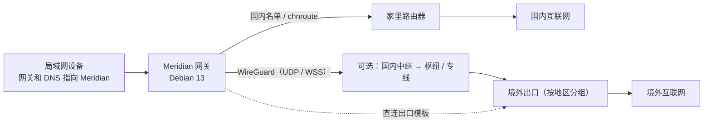

# Meridian

许可：`AGPL-3.0-only`

Meridian 是一台跑在家里局域网上的 WireGuard 策略路由网关，带一个网页面板。把设备的网关和 DNS 指向它之后：国内流量照常经家里的路由器直连；境外流量按规则和地区组，经你自己的服务器（可选国内中继、境外枢纽、专线）从你选的出口出去；隧道不通时失败关闭，不会悄悄改走本地宽带。

不用 Fake-IP，也不需要在设备上装客户端。家里路由器和已有的其他代理网关都不用改，Meridian 与它们并行，哪台设备指过来才经过它。



## 支持哪些形态

首次配置向导有四种模板，每种一张图见 [docs/user/topologies.md](docs/user/topologies.md)：

| 模板 | 路径 | 适合 |
|---|---|---|
| 直连出口 | 网关 → 出口 | 出口到家里的线路本身就够好 |
| 单中继 | 网关 → 国内服务器（兼枢纽）→ 出口 | 需要一跳国内中转 |
| 中继 + 枢纽 | 网关 → 中继 → 枢纽 → 出口，可选备用枢纽（网关经 WSS 直拨，或经一组备用中继） | 多出口、需要备用路径 |
| 专线 | 网关 → 中继 → 专线（受管主枢纽）→ 出口，可选备用枢纽 | 有专线的情况 |

## 能力与原理

```
局域网设备 ─┬─ DNS（53/853 一律劫持）→ SmartDNS 按规则解析，答案写进该规则的 nftset
            └─ 连接 → nft 按规则顺序查集合 → 打 fwmark
                 ├─ 国内 → 家里路由器直连
                 ├─ 出口 / 地区组 → 改写源地址 → WireGuard → 中继 / 枢纽按源地址选出口
                 ├─ 拒绝 → RST / ICMP 不可达
                 └─ 分不出类 / 隧道不通 → 黑洞
```

- **分流**：有序规则列表，第一条命中决定去向（地区组、出口、直连、拒绝），之后是国内名单、chnroute、默认组。网关按 DNS 学到的地址分类。
- **按域名嗅探**（可选）：从 TLS SNI / HTTP `Host` 读名字再选去向，设备绕开网关 DNS 时也能按名字分流。
- **防泄露**：DNS 劫持并拦截已知 DoH；隧道断开即黑洞，不落回本地宽带；走隧道的域名不返回 AAAA。
- **传输与切换**：网关到中继有 UDP 与 WSS 两条腿；多中继按路径质量分担；备用枢纽在主链路端到端不通时接管；地区组自动按顺序切换。
- **Cloudflare Mesh**（可选）：枢纽可在到同一出口的直连与 Mesh 之间切换。出口页显示当前承载链路、延迟、丢包和切换原因。
- **解锁探测**：从指定出口探测平台，按地区推荐出口，确认后采用。见 [docs/unlock-methods.md](docs/unlock-methods.md)。
- **观察与接入**：每秒刷新网速，持久保存国内与境外累计流量；连接、解析、链路日志（[docs/logging.md](docs/logging.md)）；远程 WireGuard 接入（[docs/remote-access.md](docs/remote-access.md)）。
- **运维**：名单可定时更新。保存拓扑后可启动自动检测、预检和按序下发，遇到阻断会暂停。
- **安装安全**：只读预检、事务式安装与回滚、撤回；下发二进制的版本与 SHA-256 固定在 `internal/artifacts/artifacts.lock`。

细节见 [架构](docs/architecture.md)。

## 快速上手

在一台 Debian 13（amd64 / arm64）上，局域网口已有静态地址：

```sh
git clone https://github.com/radowitz/Meridian.git && cd meridian
sudo bash deploy/debian/install.sh --lan-addr <网关局域网 IPv4> --version v1.0.3
sudo docker compose -f deploy/docker-compose.yml exec meridian meridian setup-code
```

浏览器打开 `http://<网关局域网 IPv4>:8787`，用终端里的一次性初始化码创建管理员，然后按向导：网关 → 模板 → 服务器（确认指纹）→ 拓扑 → 预检 → 部署。完整步骤见 [docs/user/quickstart.md](docs/user/quickstart.md)。

[v1.0.3 发布说明](https://github.com/radowitz/Meridian/releases/tag/v1.0.3) · 镜像 `ghcr.io/radowitz/meridian:v1.0.3`（amd64 / arm64）。网关连不上 ghcr.io 时，用 `--build` 在本机构建，或用 `--image-tar` 载入在别处保存的镜像。

## 文档

用户文档（[docs/user/](docs/user/)）：

- [快速上手](docs/user/quickstart.md)
- [拓扑模板](docs/user/topologies.md)
- [安装网关](docs/user/install.md)
- [升级与回滚](docs/user/upgrade-rollback.md)
- [安全模型](docs/user/security.md)
- [常见问题](docs/user/faq.md)：NAT 端口转发、UDP 被封、MTU、SSH 限速与跳转管理、IPv6
- [排错](docs/user/troubleshooting.md)：预检报告、链路日志

参考与开发文档：[架构](docs/architecture.md)、[安装参考手册](docs/install-debian13.md)、[验收清单](docs/verification.md)、[日志](docs/logging.md)、[远程接入](docs/remote-access.md)、[解锁探测](docs/unlock-methods.md)、[测试设备](docs/test-device.md)、[mihomo 配置导入](docs/mihomo-import.md)。

## 安全提示

面板握有**全部服务器的 SSH 凭据**，并能经宿主代理以 root 改动网关的数据面：拿到面板管理员权限就等于拿到所有服务器。面板没有默认口令，只监听确认过的局域网地址，宿主防火墙只放行局域网；凭据只靠文件权限保护，没有静态加密。不要把面板端口转发到公网。详见 [docs/user/security.md](docs/user/security.md)。

## 验证程度

GitHub Actions 运行 Go 和面板回归测试，部分数据面还使用 Linux 网络命名空间测试。真实环境验收请使用 [验收清单](docs/verification.md)，核对自己的网关、出口和故障切换路径。

## 开发

```sh
go test ./...                     # netns 测试需要 Linux root 和 MERIDIAN_NETNS_TEST=1，这里跳过
npm --prefix web ci
npm --prefix web test             # 面板用例（vitest，假 API）
npm --prefix web run build        # 类型检查 + 打包
MERIDIAN_BIND=127.0.0.1:8787 MERIDIAN_DATA=/tmp/meridian MERIDIAN_WEB_DIR=web/dist go run ./cmd/meridian
```

示例和测试只使用文档地址（`192.0.2.0/24`、`198.51.100.0/24`、`203.0.113.0/24`、`2001:db8::/32`、`example.invalid`）。不要把真实地址、密钥或令牌提交进仓库。

## 许可

Meridian 以 **AGPL-3.0-only**（SPDX: `AGPL-3.0-only`）发布，全文见 [LICENSE](LICENSE)。修改后通过网络向他人提供面板时，须向这些用户提供对应源码。面板打包和下发的第三方组件（其中 SmartDNS 是 GPL-3.0）及其许可见 [THIRD_PARTY_NOTICES.md](THIRD_PARTY_NOTICES.md)。

## English

Meridian is a WireGuard policy-routing gateway with a web panel for a home LAN. Point a device's gateway and DNS at it: domestic traffic goes direct through the home router; foreign traffic follows your rules and per-region exit groups through your own servers (optional domestic relay, hub or dedicated line) and fails closed when no tunnel is up. No Fake-IP, no client apps, and the existing router stays untouched.

**Topologies** (first-run wizard): direct exit, single relay, relay + hub, dedicated line. See [docs/user/topologies.md](docs/user/topologies.md).

**How it works**

- **Routing**: ordered rules, first match wins (region group, exit, direct, reject), then the domestic list, chnroute and the default group. SmartDNS writes answers into per-rule nftsets; nft marks connections; tunneled traffic is source-rewritten so relays and hubs pick the exit.
- **Sniffing** (optional): routes by TLS SNI / HTTP `Host`, even when a device bypasses the gateway DNS.
- **Leak protection**: DNS on 53/853 is hijacked and known DoH blocked; tunnel down means blackhole, never the home uplink; tunneled names get no AAAA.
- **Transport and failover**: UDP and WSS legs to relays; multiple relays weighted by path quality; standby hub takes over when the primary is unreachable end to end; region groups fail over in order.
- **Cloudflare Mesh** (optional): an extra underlay for the hub-to-exit leg; the exit stays the same.
- **Unlock probing**: probes platforms from a chosen exit and recommends exits per region. See [docs/unlock-methods.md](docs/unlock-methods.md).
- **Observability and access**: one-second throughput, persisted domestic and foreign usage; connection, DNS and link logs; remote WireGuard access.
- **Operations**: scheduled list refresh and guided automatic provisioning with preflight checks.
- **Safe install**: read-only preflight, transactional install with rollback and withdrawal; shipped binaries pinned by SHA-256 in `internal/artifacts/artifacts.lock`.

**Quick start**: on Debian 13, run `deploy/debian/install.sh --version v1.0.3`, get the one-time code with `meridian setup-code`, open `http://<gateway>:8787` and follow the wizard. See [docs/user/quickstart.md](docs/user/quickstart.md). Images: `ghcr.io/radowitz/meridian` (amd64/arm64); use `--build` or `--image-tar` if the gateway cannot reach ghcr.io.

**Security**: the panel holds SSH credentials for every server; keep it on the LAN.

**License**: AGPL-3.0-only. See [LICENSE](LICENSE).
