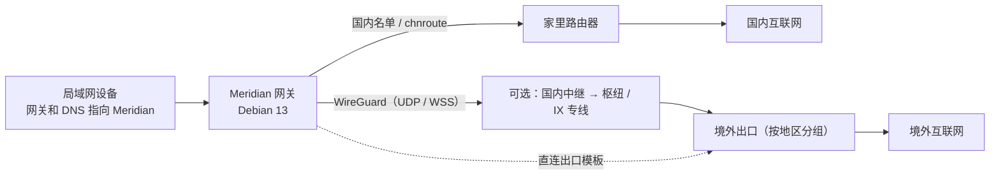

# Meridian

许可：`AGPL-3.0-only`

Meridian 是一台跑在家里局域网上的 WireGuard 策略路由网关，带一个网页面板。把设备的网关和 DNS 指向它之后：国内流量照常经家里的路由器直连；境外流量按规则和地区组，经你自己的服务器（可选国内中继、境外枢纽、IX 专线）从你选的出口出去；隧道不通时失败关闭，不会悄悄改走本地宽带。

不用 Fake-IP，也不需要在设备上装客户端。家里路由器和已有的其他代理网关都不用改，Meridian 与它们并行，哪台设备指过来才经过它。



## 支持哪些形态

首次配置向导有四种模板，每种一张图见 [docs/user/topologies.md](docs/user/topologies.md)：

| 模板 | 路径 | 适合 |
|---|---|---|
| 直连出口 | 网关 → 出口 | 出口到家里的线路本身就够好 |
| 单中继 | 网关 → 国内服务器（兼枢纽）→ 出口 | 需要一跳国内中转 |
| 中继 + 枢纽 | 网关 → 中继 → 枢纽 → 出口，可选备用枢纽（网关经 WSS 直拨，或经一组备用中继） | 多出口、需要备用路径 |
| IX 专线 | 网关 → 中继 → IX 专线（受管主枢纽）→ 出口，可选备用枢纽 | 有专线的情况 |

主要能力：

- **分流**：国内 / 境外由 SmartDNS 实解析并写入 nftset；手动规则、geosite 名单、按地区的出口组（自动按顺序切换带滞回，或手动指定）。
- **传输**：网关到中继同时有 UDP WireGuard 和 WG over WSS，自动切换；多台中继按路径质量分担；备用枢纽在主链路端到端不通时接管。
- **防泄露**：隧道断开时命中黑洞而不是家里路由器；DNS 劫持 53/853 并拦截已知 DoH；客户端 IPv6 默认不绕过隧道。
- **运维**：面板管理服务器、SSH 密钥（先确认主机指纹）、Cloudflare 账户；装机前只读预检、失败补偿、撤回；解锁探测；连接 / 解析 / 链路三种日志；远程 WireGuard 接入。
- **下发的二进制固定版本**：wstunnel、SmartDNS、gost 的版本和 SHA-256 只写在 `internal/artifacts/artifacts.lock`，主机不自己下载。

## 工作原理

### 一个包怎么走

```
局域网设备 ─┬─ DNS（53/853 一律劫持到网关）→ SmartDNS：按规则选解析器，答案地址写进该规则的 nftset
            └─ 连接 → nft 分类链（按规则顺序查集合）→ 打 fwmark
                 ├─ 国内 mark 0x64 → 经家里路由器直连，不改写
                 ├─ 出口 / 地区组 mark → ip rule 查该 mark 自己的表 → 源地址改写成该出口的中转地址
                 │     → WireGuard 隧道 → 中继 / 枢纽按源地址选出口 → 出口做公网 NAT
                 ├─ 拒绝 mark → TCP 回 RST，其他回 ICMP 不可达
                 └─ 分不出类 / 隧道不通 → 黑洞（不会落回本地宽带）
```

### 分流与打标记

- **一个有序列表，第一条命中决定去向**，和 Clash / mihomo 一样。列表之后依次是内置国内名单（geosite `cn`）、chnroute 直连、默认组。去向可以是地区组、出口、直连、拒绝。
- 网关按 DNS 学到的地址分类：安装时把规则展开成互不重叠的名单，SmartDNS 把每个名字的答案写进**第一条**匹配它的规则的集合；分类链按列表顺序查这些集合并打 mark。两个去向不同的名字解析到同一地址时，地址按更靠前的规则走。
- 每个出口和地区组有自己的 mark、路由表和中转地址（`10.66.200.0/24`、`fd66:0:0:ff::/64` 里各一个）。WireGuard 不携带 fwmark，所以网关把源地址改写成中转地址，下游中继和枢纽据此选出口；回程由连接跟踪还原。每张表垫着黑洞默认路由，转发守卫只允许出口 mark 从隧道出去。
- 可选的 QUIC 开关：走隧道的 UDP 443 回 ICMP 不可达，客户端立即改用 TCP。

### 按域名嗅探（可选）

打开「嗅探」后，网关把局域网发往 80 / 443（可改，最多 16 个端口）的 TCP 重定向到本机转发器 `meridian sniff`：从 TLS ClientHello 读 SNI、从 HTTP/1 读 `Host`，用与规则页「哪条规则会命中」相同的判断按名字选 mark，再连目标。这样设备绕开网关 DNS、直接连地址时也能按名字分流。读不到名字（无 SNI、畸形、超时、ECH 的公共名字等）时按原目的地址判断，已读到的字节原样转发。UDP 不经过它。转发器停止时连接直接被重置，不会落回按地址的路径。关闭时数据面与不开时逐字节相同。

每条经手的连接在结束时写一条记录（来源、MAC、目的、命中规则、去向、结果），这就是面板的连接日志和按设备视图，重启不丢、有大小上限。

### DNS 与防泄露

- 规则指向直连的名字和内置国内名单经国内 DoT 解析；其余名字经对应出口（或地区组）隧道里的解析器解析，没有命中的走默认组。
- 发往任意地址的 53 和 853 都重定向到网关；已知 DoH 域名返回空、已知 DoH 地址的 443 被拒绝（只覆盖清单）。
- 客户端 IPv6 默认不经网关：走隧道的域名不返回 AAAA，避免手机经路由器的 IPv6 绕过隧道；国内域名照常返回 AAAA。
- 可选「未列名单的域名也问国内 DNS」：同时问国内和出口解析器，只有国内回答**全部**是中国地址时才采用并直连，否则用出口的回答走隧道。

### 中继、枢纽与故障切换

- 网关到中继同时有 UDP WireGuard 和 WG over WSS 两条腿，按健康检查切换。
- 两台以上中继同时分担：网关持续测时延、丢包（可选定期测速），新连接按路径质量加权分到各中继；质量差的被剔除，但至少留一台。可以把中继分成主组和备用组，主组全部不通才整体切到备用组，恢复稳定后切回。切换在受保护的事务里执行：路由失败会传播、生效后才发布状态、失败补偿。
- 有备用枢纽时，主链路按端到端检查（经每条中继腿 ping 主枢纽），全部不通才切到备用枢纽；出口按连接进来的枢纽回包，不会串路。
- 地区组按顺序自动切换成员，带滞回和冷却；也可以手动指定。
- 节点上的 systemd-networkd 重启会清掉外来的 ip rule：安装时写入 networkd 配置让它保留 Meridian 的规则，故障切换循环发现规则连续两次缺失就重建。

### Cloudflare Mesh（可选）

Mesh 只用来**承载枢纽到出口那条 WireGuard 腿的外层包**，给远处的出口多一条底层路径。流量仍在出口解封装、从出口自己的上联出去，出口 IP、地区和解锁结论与直连腿相同。枢纽持续测量同一出口的直连腿和 Mesh 腿，按 `settings.path_quality` 的阈值、切换优势、连续达标时间和最短驻留自动切换；一条腿完全不通立即切另一条，两条都断就黑洞，不换出口。Mesh 节点由面板经已确认指纹的 SSH 部署和撤回，可沿用主机上已有的节点。

### 解锁探测

面板经宿主代理从指定出口发起探测（带该出口的 fwmark，访问平台前后都确认实际出口的地址和地区），按地区给出推荐出口；采用需要你确认，也可以手动指定地区组或钉死节点。指向自动地区组的规则在首选连续失败时换到同池的下一个成员，首选恢复稳定后切回。规则改动默认自动生效（可在网关设置里关掉）。所有适配器只在合成样本上测过，见 [docs/unlock-methods.md](docs/unlock-methods.md)。

### 观察与接入

- **实时吞吐**：按国内 / 国外、上行 / 下行四个计数器显示。
- **日志**：连接日志（嗅探）、解析日志、链路日志（隧道和切换），见 [docs/logging.md](docs/logging.md)。
- **远程接入**：网关上的 `mra` WireGuard 接口，手机、笔记本连回来后和局域网设备走同一套分流和防泄露；设备配置只显示一次，见 [docs/remote-access.md](docs/remote-access.md)。

### 安装安全

- 装机前对每台服务器只读预检（端口、已有业务、包、networkd 等），有阻断项不执行。
- 安装是事务：失败时补偿，或明确列出残留；网关和节点都可以回滚到上一版、撤回到兜底状态。
- 面板只监听局域网地址，首次需要终端里的一次性初始化码；SSH 凭据和 Cloudflare 令牌存在单独目录（0700 / 0600），不进拓扑和快照，但没有静态加密。

## 快速上手

在一台 Debian 13（amd64 / arm64）上，局域网口已有静态地址：

```sh
git clone https://github.com/<owner>/meridian.git && cd meridian
sudo bash deploy/debian/install.sh --lan-addr <网关局域网 IPv4> --build
sudo docker compose -f deploy/docker-compose.yml exec meridian meridian setup-code
```

浏览器打开 `http://<网关局域网 IPv4>:8787`，用终端里的一次性初始化码创建管理员，然后按向导：网关 → 模板 → 服务器（确认指纹）→ 拓扑 → 预检 → 部署。完整步骤见 [docs/user/quickstart.md](docs/user/quickstart.md)。

目前**还没有发布预构建镜像**：仓库里只有手动触发的镜像构建工作流，所以上面用 `--build` 在本机构建。发布后可以改用 `--version vX.Y.Z`。

## 文档

用户文档（[docs/user/](docs/user/)）：

- [快速上手](docs/user/quickstart.md)
- [拓扑模板](docs/user/topologies.md)
- [安装网关](docs/user/install.md)
- [升级与回滚](docs/user/upgrade-rollback.md)
- [安全模型](docs/user/security.md)
- [常见问题](docs/user/faq.md)：NAT 端口转发、UDP 被封、MTU、SSH 限速与跳转管理、IPv6
- [排错](docs/user/troubleshooting.md)：预检报告、链路日志

参考与开发文档：[架构](docs/architecture.md)、[安装参考手册](docs/install-debian13.md)、[验收清单](docs/verification.md)、[日志](docs/logging.md)、[远程接入](docs/remote-access.md)、[解锁探测](docs/unlock-methods.md)、[测试设备](docs/test-device.md)、[mihomo 配置导入](docs/mihomo-import.md)。

## 安全提示

面板握有**全部服务器的 SSH 凭据**，并能经宿主代理以 root 改动网关的数据面：拿到面板管理员权限就等于拿到所有服务器。面板没有默认口令，只监听确认过的局域网地址，宿主防火墙只放行局域网；凭据只靠文件权限保护，没有静态加密。不要把面板端口转发到公网。详见 [docs/user/security.md](docs/user/security.md)。

## 验证程度

代码有 Go 与面板的自动化回归，部分数据面有 Linux 网络命名空间测试；仓库里的 `docs/evidence/` 是早期版本的历史执行记录。**这一版的安装脚本、升级 / 回滚、管理防火墙、首次配置向导、四种模板和镜像工作流都还没有在真实主机和真实网络上完整跑过**。自动化测试只证明生成的配置符合预期，不证明没有泄漏；上线前请按[验收清单](docs/verification.md)在真实设备上签收。

## 开发

```sh
go test ./...                     # netns 测试需要 Linux root 和 MERIDIAN_NETNS_TEST=1，这里跳过
npm --prefix web ci
npm --prefix web test             # 面板用例（vitest，假 API）
npm --prefix web run build        # 类型检查 + 打包
MERIDIAN_BIND=127.0.0.1:8787 MERIDIAN_DATA=/tmp/meridian MERIDIAN_WEB_DIR=web/dist go run ./cmd/meridian
```

示例和测试只使用文档地址（`192.0.2.0/24`、`198.51.100.0/24`、`203.0.113.0/24`、`2001:db8::/32`、`example.invalid`）。不要把真实地址、密钥或令牌提交进仓库。

## 许可

Meridian 以 **AGPL-3.0-only**（SPDX: `AGPL-3.0-only`）发布，全文见 [LICENSE](LICENSE)。修改后通过网络向他人提供面板时，须向这些用户提供对应源码。面板打包和下发的第三方组件（其中 SmartDNS 是 GPL-3.0）及其许可见 [THIRD_PARTY_NOTICES.md](THIRD_PARTY_NOTICES.md)。

## English summary

Meridian is a WireGuard policy-routing gateway with a web panel for a home LAN. Devices that use it as their gateway and DNS reach domestic destinations directly through the home router, while foreign traffic follows rules and per-region exit groups through your own servers (optional domestic relay, hub or IX line) and fails closed when no tunnel is up. A first-run wizard offers four templates (direct exits, single relay, relay + hub, IX line). Install on Debian 13 with `deploy/debian/install.sh`, then create the admin account with the one-time code from `meridian setup-code`. The panel holds SSH credentials for every server; keep it on the LAN. No prebuilt image has been published yet, and the installer, upgrade/rollback, wizard and templates have not been run end to end on real hosts. See `docs/user/` (Chinese) for details. License: AGPL-3.0-only.
