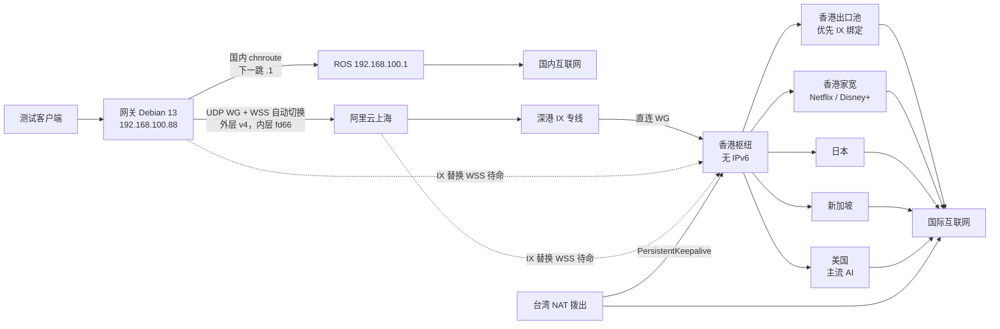

# Meridian

Meridian 是一台跑在局域网里的多出口 WireGuard 策略路由网关。测试设备把 IPv4 网关和 DNS 指到 `192.168.100.88` 之后，国内流量仍从 ROS `192.168.100.1` 直连，境外流量必须经过「家宽 → 阿里云上海 → 深港 IX → 香港枢纽 → 出口」。现有的 mihomo 网关和 RouterOS 配置都不改，Meridian 与它们并行。

数据面用内核 WireGuard 和 nftables，不用 Fake-IP。域名由 SmartDNS 做国内 / 境外实解析，并把结果写入 nftset。控制面是只监听局域网的 Go API 加 React Flow 拓扑面板。



实线是主路。虚线是预先配好、默认不进路由表的 IX 替换隧道。Mesh 只允许作为「枢纽 → 出口」的备路，跑在枢纽和出口上的独立网络命名空间里，不能绕过 IX，也不装在这台家宽网关上。

## 这一期有什么

- 每出口一张路由表和 fwmark。国内走 chnroute / chnroute6，默认境外是香港池里 IX 绑定的出口。
- 家宽到阿里云同时生成 UDP WireGuard 和 WG-over-WSS，按握手和探测切换，带回滞。MTU 按 PPPoE 1492 规划：UDP 1412，WSS 1360，低于 1280 拒绝。
- IX 替换用的两条 WSS（阿里云 → 枢纽、家宽 → 枢纽）随配置一起生成并探测，替换模式关掉时不是默认下一跳。
- 隧道内使用 `fd66::/48`。这条 ULA 不会指向 ROS。有 IPv6 的出口做 NAT66，没有的出口过滤 AAAA，仍走同一出口的 v4。
- 台湾和香港家宽按「由对端拨向枢纽」生成配置：枢纽不写公网 Endpoint，PersistentKeepalive 必须打开。
- DNS 劫持 53/853，并按已知清单拦截 DoH。清单不能覆盖所有 DoH，文档里写明了这个边界。
- 面板可以加节点、拉线选择传输、校验必经 IX、编译配置、看差分、下发和回滚，并带手动规则和 geosite 默认表。
- SSH 装机脚本用 `wg syncconf` 更新，避免拆掉 NAT 映射。演练模式不连接远端。
- 二期：同一池里可以有多台香港出口和多条家宽。健康检查在枢纽上做，连续失败才换下一跳，并带回滞。Mesh 以 sidecar 跑在枢纽和出口上。
- 三期：纯 IPv6 出口经双栈中继或 Mesh 到达；NAT64 只生成占位文件；面板有防泄露清单，并写明 WebRTC host 候选的 GUA 限制。
- 验收分三级：`go test` 的自动化回归、在 Linux 上实际运行并存档的集成证据（netns 测试、`meridian-verify.sh` 等），以及测试机 / ROS / 断隧道 / 抓包的人工签收。单元测试和面板的「配置包含」都不证明没有泄漏，见[验收清单](docs/verification.md)。

## 路线图

| 阶段 | 内容 |
| --- | --- |
| 一期 | 必经 IX 的 WG、UDP/WSS、预置替换隧道、香港池、ULA、默认规则和手动规则、台湾拨出、家宽属性 |
| 二期（本仓库） | 多港机与多家宽池化、按成员做健康检查和滞回、Mesh sidecar、每 6 小时解锁测试、同网段 rp_filter / 重定向验收 |
| 三期（本仓库） | 纯 IPv6 与「v6 入 v4 出」走双栈中继或 Mesh；NAT64 只预留、不进路由表；防泄露清单，含 WebRTC host 候选的 GUA 限制 |

纯 IPv6 出口在枢纽没有 IPv6、又没有把绕行真正接上时，面板会拒绝保存。家宽网关不运行 Mesh。NAT64 即使在面板里标成启用，也不会改写现有 IPv4 路由。

## 快速开始

在全新的 Debian 13 上，地址固定为 `192.168.100.88/24`，与 ROS 同一二层。不要把这台机器的上游接到旧的 mihomo 后面。

```bash
sudo bash deploy/debian/install.sh
sudo docker compose -f deploy/docker-compose.yml up -d --build
```

面板口令在面板容器的命名卷里，宿主上直接 `cat /var/lib/meridian/panel.token` 通常读不到，要从容器里读：

```bash
sudo docker compose -f deploy/docker-compose.yml exec meridian cat /var/lib/meridian/panel.token
```

浏览器打开 `http://192.168.100.88:8787`。示例拓扑里的 `203.0.113.0/24`、`198.51.100.0/24`、`2001:db8::/32` 和 `example.invalid` 都是文档占位，下发前必须换成你自己的端点。不要把真实地址、密钥或 token 提交进仓库。

继续阅读：

- [Debian 13 安装](docs/install-debian13.md)
- [测试设备](docs/test-device.md)
- [验收清单](docs/verification.md)
- [数据面说明](docs/architecture.md)

本地开发和测试：

```bash
go test ./...
cd web && npm ci && npm run build
MERIDIAN_BIND=127.0.0.1:8787 MERIDIAN_DATA=/tmp/meridian MERIDIAN_WEB_DIR=web/dist go run ./cmd/meridian
```

## English

Meridian is a LAN policy-routing gateway. Test clients use `192.168.100.88` as their IPv4 gateway and DNS. China prefixes go straight out via RouterOS `192.168.100.1`. Everything else must cross Aliyun Shanghai, the Shenzhen–Hong Kong IX, and the Hong Kong hub before it reaches an exit. The existing mihomo host and RouterOS stay untouched.

The compiler covers the IX path, pool failover, a Mesh sidecar that cannot bypass the IX, six-hour unlock hysteresis, and pure-IPv6 reachability through a dual-stack relay or Mesh. Streaming/AI unlock tests can be started from the panel (解锁 → 面板探测) and run on the same chain as the six-hour schedule: meridian-host sends them through the chosen exit's fwmark and transit address over a forced IPv4 or IPv6, confirms the actual egress before and after, and only fixed catalog targets are probed; real-platform verdicts and the on-gateway egress still need human sign-off (docs/verification.md). NAT64 is reserved and is not installed into the routing table. Documentation addresses only; do not commit real endpoints or keys. Read the panel token from inside the container (`docker compose -f deploy/docker-compose.yml exec meridian cat /var/lib/meridian/panel.token`); it lives in a named volume, not on the host path. Unit tests and the panel checklist only check generated configuration; they do not prove the absence of leaks. Release needs the gateway `meridian-verify.sh` output, isolated Linux integration logs and human sign-off on a real client, ROS, a tunnel cut and packet captures (docs/verification.md).
