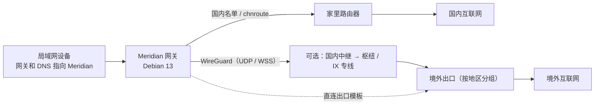

# Meridian

许可：`AGPL-3.0-only`

Meridian 是一台跑在家里局域网上的 WireGuard 策略路由网关，带一个网页面板。把设备的网关和 DNS 指向它之后：国内流量照常经家里的路由器直连；境外流量按规则和地区组，经你自己的服务器（可选国内中继、境外枢纽、IX 专线）从你选的出口出去；隧道不通时失败关闭，不会悄悄改走本地宽带。

不用 Fake-IP，也不需要在设备上装客户端。家里路由器和已有的其他代理网关都不用改，Meridian 与它们并行，哪台设备指过来才经过它。



## 支持哪些形态

首次配置向导有四种模板，每种一张图见 [docs/user/topologies.md](docs/user/topologies.md)：

| 模板 | 路径 | 适合 |
|---|---|---|
| 直连出口 | 网关 → 出口 | 出口到家里的线路本身就够好 |
| 单中继 | 网关 → 国内服务器（兼枢纽）→ 出口 | 需要一跳国内中转 |
| 中继 + 枢纽 | 网关 → 中继 → 枢纽 → 出口，可选备用枢纽（网关经 WSS 直拨，或经一组备用中继） | 多出口、需要备用路径 |
| IX 专线 | 网关 → 中继 → IX 专线（受管主枢纽）→ 出口，可选备用枢纽 | 有专线的情况 |

主要能力：

- **分流**：国内 / 境外由 SmartDNS 实解析并写入 nftset；手动规则、geosite 名单、按地区的出口组（自动按顺序切换带滞回，或手动指定）。
- **传输**：网关到中继同时有 UDP WireGuard 和 WG over WSS，自动切换；多台中继按路径质量分担；备用枢纽在主链路端到端不通时接管。
- **防泄露**：隧道断开时命中黑洞而不是家里路由器；DNS 劫持 53/853 并拦截已知 DoH；客户端 IPv6 默认不绕过隧道。
- **运维**：面板管理服务器、SSH 密钥（先确认主机指纹）、Cloudflare 账户；装机前只读预检、失败补偿、撤回；解锁探测；连接 / 解析 / 链路三种日志；远程 WireGuard 接入。
- **下发的二进制固定版本**：wstunnel、SmartDNS、gost 的版本和 SHA-256 只写在 `internal/artifacts/artifacts.lock`，主机不自己下载。

## 快速上手

在一台 Debian 13（amd64 / arm64）上，局域网口已有静态地址：

```sh
git clone https://github.com/<owner>/meridian.git && cd meridian
sudo bash deploy/debian/install.sh --lan-addr <网关局域网 IPv4> --build
sudo docker compose -f deploy/docker-compose.yml exec meridian meridian setup-code
```

浏览器打开 `http://<网关局域网 IPv4>:8787`，用终端里的一次性初始化码创建管理员，然后按向导：网关 → 模板 → 服务器（确认指纹）→ 拓扑 → 预检 → 部署。完整步骤见 [docs/user/quickstart.md](docs/user/quickstart.md)。

目前**还没有发布预构建镜像**：仓库里只有手动触发的镜像构建工作流，所以上面用 `--build` 在本机构建。发布后可以改用 `--version vX.Y.Z`。

## 文档

用户文档（[docs/user/](docs/user/)）：

- [快速上手](docs/user/quickstart.md)
- [拓扑模板](docs/user/topologies.md)
- [安装网关](docs/user/install.md)
- [升级与回滚](docs/user/upgrade-rollback.md)
- [安全模型](docs/user/security.md)
- [常见问题](docs/user/faq.md)：NAT 端口转发、UDP 被封、MTU、SSH 限速与跳转管理、IPv6
- [排错](docs/user/troubleshooting.md)：预检报告、链路日志

参考与开发文档：[架构](docs/architecture.md)、[安装参考手册](docs/install-debian13.md)、[验收清单](docs/verification.md)、[日志](docs/logging.md)、[远程接入](docs/remote-access.md)、[解锁探测](docs/unlock-methods.md)、[测试设备](docs/test-device.md)、[mihomo 配置导入](docs/mihomo-import.md)。

## 安全提示

面板握有**全部服务器的 SSH 凭据**，并能经宿主代理以 root 改动网关的数据面：拿到面板管理员权限就等于拿到所有服务器。面板没有默认口令，只监听确认过的局域网地址，宿主防火墙只放行局域网；凭据只靠文件权限保护，没有静态加密。不要把面板端口转发到公网。详见 [docs/user/security.md](docs/user/security.md)。

## 验证程度

代码有 Go 与面板的自动化回归，部分数据面有 Linux 网络命名空间测试；仓库里的 `docs/evidence/` 是早期版本的历史执行记录。**这一版的安装脚本、升级 / 回滚、管理防火墙、首次配置向导、四种模板和镜像工作流都还没有在真实主机和真实网络上完整跑过**。自动化测试只证明生成的配置符合预期，不证明没有泄漏；上线前请按[验收清单](docs/verification.md)在真实设备上签收。

## 开发

```sh
go test ./...                     # netns 测试需要 Linux root 和 MERIDIAN_NETNS_TEST=1，这里跳过
npm --prefix web ci
npm --prefix web test             # 面板用例（vitest，假 API）
npm --prefix web run build        # 类型检查 + 打包
MERIDIAN_BIND=127.0.0.1:8787 MERIDIAN_DATA=/tmp/meridian MERIDIAN_WEB_DIR=web/dist go run ./cmd/meridian
```

示例和测试只使用文档地址（`192.0.2.0/24`、`198.51.100.0/24`、`203.0.113.0/24`、`2001:db8::/32`、`example.invalid`）。不要把真实地址、密钥或令牌提交进仓库。

## 许可

Meridian 以 **AGPL-3.0-only**（SPDX: `AGPL-3.0-only`）发布，全文见 [LICENSE](LICENSE)。修改后通过网络向他人提供面板时，须向这些用户提供对应源码。面板打包和下发的第三方组件（其中 SmartDNS 是 GPL-3.0）及其许可见 [THIRD_PARTY_NOTICES.md](THIRD_PARTY_NOTICES.md)。

## English summary

Meridian is a WireGuard policy-routing gateway with a web panel for a home LAN. Devices that use it as their gateway and DNS reach domestic destinations directly through the home router, while foreign traffic follows rules and per-region exit groups through your own servers (optional domestic relay, hub or IX line) and fails closed when no tunnel is up. A first-run wizard offers four templates (direct exits, single relay, relay + hub, IX line). Install on Debian 13 with `deploy/debian/install.sh`, then create the admin account with the one-time code from `meridian setup-code`. The panel holds SSH credentials for every server; keep it on the LAN. No prebuilt image has been published yet, and the installer, upgrade/rollback, wizard and templates have not been run end to end on real hosts. See `docs/user/` (Chinese) for details. License: AGPL-3.0-only.
