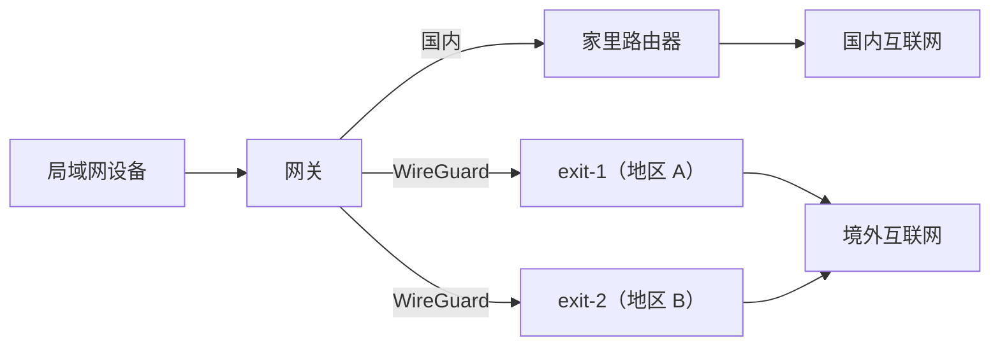
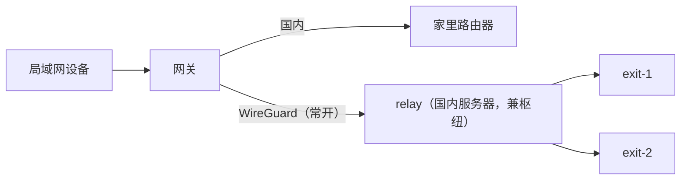
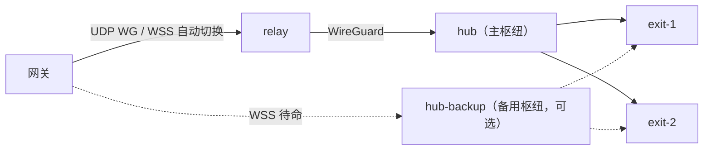
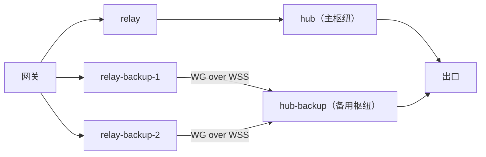
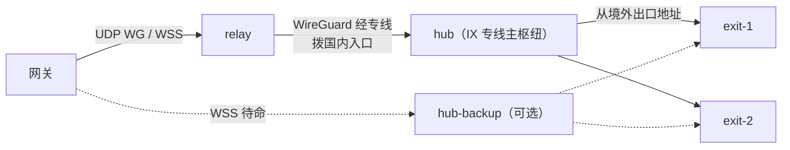

# 拓扑模板

首次配置向导提供四种模板。每种都只问它需要的东西，生成的是普通拓扑：保存前要通过同样的校验，之后可以在「拓扑」页继续改（加出口、加备用、改传输）。图里的名称都是模板生成的节点 ID 或角色，地址都是示意。

共同点：

- 国内流量（chnroute 和国内名单）由网关直接交给家里路由器，不进隧道。
- 境外流量按规则和地区组选出口；出口按地区自动分组（每个地区一个自动组），默认地区收下没有命中规则的境外流量。
- 隧道断了是**失败关闭**：流量被丢弃或拒绝，不会改从家里的宽带直接出去。

## 1. 直连出口（`direct`）

网关自己拨每个出口。适合出口到家里的线路本身就够好、不需要国内中转的情况。

- 地区组的切换由网关自己做（同样的健康检查和滞回）；面板经网关上的宿主代理读回组的实际状态（`/v1/groups/state`），不走 SSH。
- 没有中继，所以没有测速和多中继分担。
- 暂不支持（保存时校验报 `direct_unsupported`）：挂在中继出口后面的出口、外部 SOCKS 出口、纯 IPv6 出口的绕行、WSS / 待命 / Mesh 链路。需要这些时选带枢纽的模板。

## 2. 单中继（`relay`）

一台国内服务器既接网关、又选出口，在拓扑里它就是主枢纽。

- 不支持备用枢纽，也不支持网关到它的 UDP / WSS 双腿（校验报 `relayless_unsupported`）。需要这些时用「中继 + 枢纽」。

## 3. 中继 + 枢纽（`relay_hub`）

网关 → 国内中继 → 境外枢纽 → 出口。网关到中继同时有 UDP WireGuard 和 WG over WSS 两条腿，按握手和探测自动切换。可选一台备用枢纽，主链路端到端不通时改走备用。

备用枢纽有两种到达方式，二选一：

- **网关直拨**（不填备用中继时）：网关到备用枢纽一条待命的 WG over WSS。
- **经备用中继组**（填了「备用中继」时）：每台备用中继各有一条网关 → 备用中继（UDP / WSS）和一条备用中继 → 备用枢纽（WG over WSS），网关不直接拨备用枢纽：

- 每个出口和两个枢纽各连一条 WireGuard；出口按连接从哪个枢纽来就从哪个枢纽回包。
- 面板显示当前承载的枢纽，并从它读取地区组的实际状态。
- 以后再加国内中继，就是「多中继同时分担」：每个新连接按流哈希固定到一台中继，权重按网关测得的路径质量自动调整（详见[架构](../architecture.md)「多中继同时分担」）。

## 4. IX 专线（`ix`）

国内中继经一条 IX / 专线到境外。专线机器在拓扑里是受管的主枢纽，有两个地址：**国内入口 IPv4**（只给中继拨）和**境外出口 IPv4**（连出口用）。可选一台备用枢纽，网关经 WSS 待命直拨。

- 专线机器的 SSH 常常只能经中继上的端口转发到达；面板支持密码登录，也支持「经受管中继跳转」的管理通道（见 [FAQ](faq.md#ssh-被限速--只能经中继管理)）。
- 主路径必须经过 IX：保存时校验不允许中继绕开专线直连境外。

## 验证程度

四种模板的生成、校验和编译有自动化回归（`internal/compile/templates_test.go`、`internal/compile/direct_test.go` 等），部分形态有网络命名空间测试。直连出口、单中继、备用中继组、IX 专线**都还没有在真实主机和真实网络上完整跑过**，见 [open-source-checklist](../open-source-checklist.md)「没有在真实主机上验证过的部分」。
